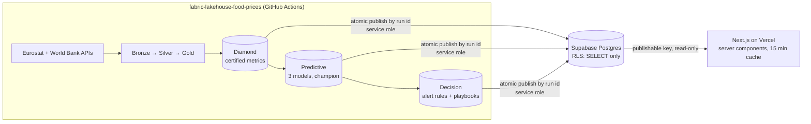

# From farm to shelf — public dashboard

**How do farm-gate price shocks reach the shelf in 27 European countries, what comes next year, and what should each data team do about it?**

Live: **https://food-price-transmission-dashboard.vercel.app**

This is the **serving and experience layer** of [fabric-lakehouse-food-prices](https://github.com/alejandrocaldentey/fabric-lakehouse-food-prices). It computes no definitions: every number is a certified metric, a backtested forecast or a fired alert published by the pipeline, and every number can be traced back to the value Eurostat published.

| Page | What it answers |
|---|---|
| **Story** | How far farm-gate and shelf prices moved since any year, how closely the shelf follows the farm, and where in Europe the gap is widest. Inline controls, a map with a year player, ranking. |
| **Forecast** | Next year's food inflation per country from the champion model, its 80% interval, the out-of-sample backtest of three models, the champion rule, and a shock simulator. |
| **Decisions** | Alerts for the selected year, each with a play for four technical roles: business decision, data work, KPI and horizon. Alert history heat map and the rule monitor. |
| **Architecture** | Lineage from API to page, rendered from the run's own metadata: row counts, data contracts, the SQL of each table, cost per scenario and the decision records. |

## Architecture



| Decision | Why |
|---|---|
| Server components read Supabase over REST | The key stays on the server; pages share state by URL (`?c=ESP`) |
| Every snapshot read is filtered on the latest **complete** run id | A page never mixes two runs or sees a half-written publish |
| The simulator applies published coefficients; nothing is fitted in the browser | One model definition. `scripts/parity.ts` runs before every build and **fails the deploy** if the formula does not reproduce every published forecast ([ADR 0009](https://github.com/alejandrocaldentey/fabric-lakehouse-food-prices/blob/main/docs/adr/0009-where-predictions-and-alerts-run.md)) |
| "Trace this number" built only from published metadata | Raw Eurostat value, chain-linking factor, formula, contracts passed and commit, for any figure |
| Charts are hand-built SVG on d3-scale and d3-shape; the map is pre-projected at build time | Full control of the reading experience; the browser ships paths, not a geometry library |
| Colour: farm-gate always orange, shelf always blue; palettes validated for colour-vision deficiency in light and dark | A colour means the same thing on every page, for every reader |
| 15-minute revalidation | Data change weekly; a publish shows up within 15 minutes and the free tiers stay idle |

## Run locally

```bash
npm install
SUPABASE_PUBLISHABLE_KEY=<publishable key> npm run dev
SUPABASE_PUBLISHABLE_KEY=<publishable key> npm run build   # runs the parity test first
npm run map -- <path to country_codes.csv>                 # rebuild the pre-projected map
```

## Data

Eurostat (`apri_pi_outa`, `prc_hicp_aind`) and World Bank (`FP.CPI.TOTL.ZG`), reused with attribution. Map: Natural Earth via world-atlas.

---

Designed and built by [Alejandro Caldentey](https://github.com/alejandrocaldentey).
