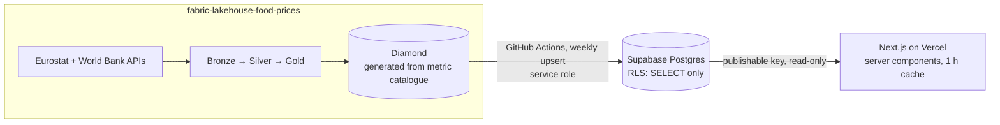

# Food price transmission — public dashboard

**Do farm-gate price shocks reach the plate?** A guided, country-by-country view of how changes in what European farmers are paid show up in what consumers pay for food.

This is the **serving layer** of [fabric-lakehouse-food-prices](https://github.com/alejandrocaldentey/fabric-lakehouse-food-prices). It shows only certified metrics from the Diamond layer; no number is computed here.

## Architecture



| Decision | Why |
|---|---|
| Server components fetch Supabase over REST | The key stays on the server; pages are shareable by URL (`/?country=ESP`) |
| Publishable key + RLS `SELECT` only | The database can be read by anyone and written by no one but CI |
| Labels, units and descriptions come from `food_price_metric` | The dashboard shows the same definitions as Power BI and the metric catalogue |
| 1-hour revalidation | Data changes weekly; the page stays fast and the free tiers stay idle |

The full reasoning is in [ADR 0008](https://github.com/alejandrocaldentey/fabric-lakehouse-food-prices/blob/main/docs/adr/0008-public-demo-supabase-vercel.md) of the lakehouse repo.

## Run locally

```bash
npm install
SUPABASE_PUBLISHABLE_KEY=<publishable key> npm run dev
```

## Roadmap

- AI layer: ask questions in natural language over the certified metrics.
- Alerts generated from thresholds declared in the metric catalogue (e.g. gap above 5 pp).

## Data

Eurostat (`apri_pi_outa`, `prc_hicp_aind`) and World Bank (`FP.CPI.TOTL.ZG`), reused with attribution.

---

Architecture, decisions and review by [Alejandro Caldentey](https://github.com/alejandrocaldentey). Built with AI assistance.
